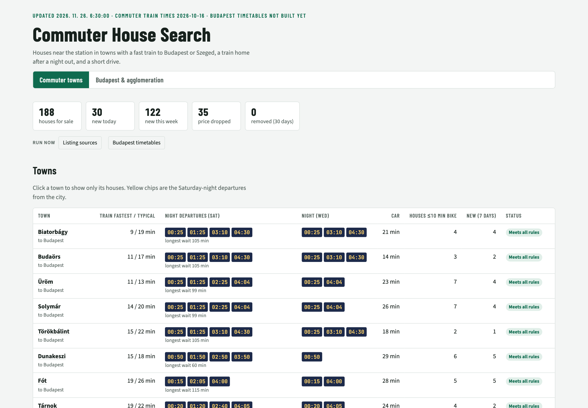
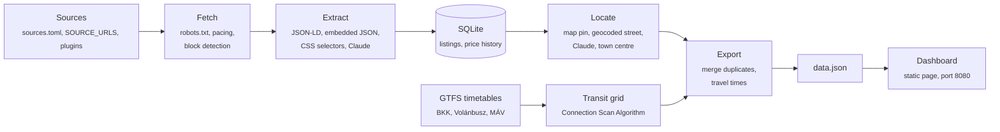

# househunt

[](https://github.com/raczcsaba/househunt/actions/workflows/ci.yml)
[](pyproject.toml)
[](LICENSE)
[](https://github.com/astral-sh/ruff)

A self-updating list of houses for sale around Budapest, from the property sites **you** choose, with
what matters when you commute: distance to the station, door-to-door public transport time, the last
train home on a Saturday night, and driving time.

- **Two views:**
  - **Commuter towns:** houses near the station in 43 towns with a fast train to Budapest or Szeged,
    a train home after a night out, and a short drive.
  - **Budapest & agglomeration:** every house in the 23 districts and 80 agglomeration towns, each with
    its own door-to-door time to Blaha Lujza tér by public transport and by car, plus the trip home at night.
- **Any site, no code:** give it search URLs. It finds the listings by itself (see
  [How sources work](#how-sources-work)).
- **Change tracking:** the day each house appeared, its price history, and the day it disappeared.
- **Duplicate merging:** the same house on several sites, or reposted, becomes one row with every link.
- **Location:** from the listing's map pin, or a street in its address geocoded with OpenStreetMap, or
  (optional) Claude reading the ad text for a street, landmark or "near the station" remark.
- **Travel times from real timetables:** BKK and Volánbusz GTFS (official open data), MÁV trains from
  MÁV's free official GTFS, car times from OSRM. Rebuilt weekly.
- **Dashboard (port 8080):** new today or this week, price drops, removed ads; filters by town, price,
  size, plot, bike, train and car time; "Run now" buttons; optional push messages via ntfy.

Everything runs in one Docker container.


<sub>The dashboard, filled with invented demo listings.</sub>

## Quick start

```bash
git clone https://github.com/raczcsaba/househunt && cd househunt
cp .env.example .env
cp config/sources.example.toml config/sources.toml
# edit config/sources.toml (or set SOURCE_URLS in .env), then:
docker compose up -d --build
docker compose logs -f
```

Dashboard: `http://<server>:8080`. On first start the container downloads about 170 MB of BKK and
Volánbusz timetables and builds the travel-time grid (up to about half an hour); the first scrape runs at the same time.

## How sources work

A source is a search-results URL with placeholders, either in `config/sources.toml`:

```toml
[[source]]
name = "mysite"
url = "https://www.example.hu/elado-haz/{town_slug}?page={page}"
delay = 5
```

or just a list in `.env`: `SOURCE_URLS=https://www.example.hu/elado-haz/{town_slug}?page={page}`.

- `{town}`, `{town_slug}`, `{district}`, `{district_roman}`: one search per town. Without them, the URL is
  one area-wide search and every listing is matched to a town by its address.
- `{page}` counts up until a page brings nothing new (or `max_pages`).

On each page househunt looks for listings in this order, and uses the first that works:

1. **schema.org JSON-LD:** the structured data sites publish for search engines.
2. **Embedded page data:** the JSON that modern sites ship inside the page (`__NEXT_DATA__`, `__NUXT__`,
   `window.__STATE__`…). It finds the list of objects that look like listings (a price plus a link) and
   maps fields like `price`, `floorArea`, `plotSize`, `rooms`, `latitude` by name, Hungarian names included.
3. **CSS selectors** that you give in the config, for plain HTML sites.
4. **Claude** reads the page text, if `ANTHROPIC_API_KEY` is set. It's the slowest and costs a little
   per page, so it is used only when nothing else worked, and capped per run.

Before adding a site, test it:

```bash
docker compose exec househunt python -m app.main probe "https://www.example.hu/elado-haz/budaors"
```

It shows whether robots.txt allows the URL, whether the site lets you in, which method found listings,
and the first few.

`render = "browser"` loads JavaScript-only pages in headless Chromium. `details = true` also opens each new
listing once, for its map pin and full ad text. All options: [`config/sources.example.toml`](config/sources.example.toml).

### Staying within the rules

househunt is built to read only what a site allows, and the built-in sources enforce this:

- **robots.txt** is checked for every URL, and a disallowed URL is never requested. Crawl-delay is honoured.
- **Honest identification:** requests say they come from househunt, with your `CONTACT_EMAIL`, so a site
  owner can tell what it is and reach you.
- **Slow by design:** at least 1.5 s between requests to a site (default 3 s), one page at a time.
- **No working around blocks:** a 401/403/429 answer or a bot check (Cloudflare challenge, captcha) stops
  that source for the run, and the dashboard says so. There are no stealth browsers, fake fingerprints,
  proxy rotation or captcha solving.
- **No personal data:** seller names and phone numbers are never extracted, and phone numbers are removed
  from ad text. Photos aren't downloaded. Each listing keeps facts about the house and a link to the original.

Three things stay with you:

- **Check each site's terms of use.** Many property portals forbid automated collection even where
  robots.txt allows it.
- **Personal, non-commercial use only.** In the EU, listing databases are protected by the sui generis
  database right, so republishing or reselling the data is a different matter (see CJEU C-202/12
  *Innoweb*, C-762/19 *CV-Online*).
- **Prefer official feeds** when a site offers an API, a data export or an RSS feed.

The result: some big portals will simply refuse househunt, and that's the intended behaviour.

### Plugins

For a site that needs real code, drop a Python file into `plugins/`. Plugins are git-ignored, so they stay
on your machine; see [`plugins/README.md`](plugins/README.md) and `plugins/example_site.py`. Plugins are
your own responsibility: the rules above apply only to what goes through `app/fetch.py`.

## Settings (`.env`)

| Variable | Default | Meaning |
|---|---|---|
| `SOURCE_URLS` | empty | Search URLs (space separated), as an alternative to `config/sources.toml`. |
| `SOURCES_FILE`, `PLUGINS_DIR` | `config/sources.toml`, `plugins` | Where sources and plugins are read from. |
| `SCHEDULE` | `0 6 * * *` | Scrape (cron syntax, Budapest time). |
| `REQUEST_DELAY` | `3` | Default seconds between requests to one site (minimum 1.5). |
| `CONTACT_EMAIL` | empty | Put in the User-Agent and sent to the OpenStreetMap geocoder. Recommended. |
| `MAX_DETAILS_PER_RUN` | `400` | Detail pages opened per run (sources with `details = true`). |
| `NOTIFY_URL` | empty | ntfy (or any URL accepting a POST body) for push messages. |
| `DASHBOARD_TOKEN` | empty | Protects the "Run now" buttons. |
| `AREAS` | `commuter,budapest` | Which areas to cover. |
| `GRID_SCHEDULE` | `0 2 * * 1` | Rebuild of the Budapest timetable grid (BKK publishes weekly). |
| `MAV_GTFS_URL` | empty | MÁV's official GTFS ([free registration](https://www.mavcsoport.hu/gtfs-igenybejelento)). Without it the grid has no MÁV trains. |
| `MAV_PLANNER` | `0` | `1` queries MÁV's public journey planner for train times instead (unofficial; no published API terms). Also enables the monthly commuter-town refresh (`TRANSIT_SCHEDULE`, default `0 4 1 * *`). |
| `BP_RADIUS_KM` | `45` | How far from the centre timetables are loaded. |
| `OSRM_URL` | public demo | Your own OSRM server for car times. The public demo is for light use only. |
| `ANTHROPIC_API_KEY` | empty | Turns on the Claude steps: reading ad text for locations, and pages without structured data. |
| `CLAUDE_MODEL` | `claude-opus-5-5` | `claude-haiku-5-5` costs far less. |
| `CLAUDE_MAX_PER_RUN` | `400` | Cap on ads sent to Claude per run for locations. |
| `SOURCES`, `TOWNS` | all | Comma-separated subsets, for testing. |

### How exact are the Budapest times?

- **Location:** a house with a map pin or a street gets times from its own spot. The rest use their
  district's or town's centre, marked "from district/town centre" on the dashboard.
- **Trains:** with MÁV GTFS, transfers between trains are modelled. With `MAV_PLANNER=1`, trains are
  direct station-to-terminal connections only.
- **Car:** times assume no traffic. Add 20–50% at rush hour inside Budapest.

### What the Claude steps cost

- **Locating ads:** only ads with neither a map pin nor a street in their address are sent, at about
  1,500–2,500 input tokens each, roughly 1 US cent per ad on `claude-opus-5-5`.
- **Reading pages:** one page is typically 5,000–20,000 tokens. It is used only for sources where nothing
  else works, and capped with `claude_pages_per_run`.

## Commands

```bash
docker compose exec househunt python -m app.main run            # scrape now
docker compose exec househunt python -m app.main probe "<url>"  # test a search URL
docker compose exec househunt python -m app.main grid           # rebuild Budapest timetables now
```

## Architecture



- **Sources** (`app/sources/`) turn a search URL template into the list of pages to read, one per town and page.
- **Fetch** (`app/fetch.py`) is the only way configured sources reach the network, so the rules in
  [Staying within the rules](#staying-within-the-rules) are enforced in one place.
- **Extract** (`app/extract.py`) is site-independent: it tries structured data first and falls back to
  selectors or Claude only when needed.
- **Locate** (`app/locate.py`) improves each listing's position step by step and records how it was found.
- **Transit grid** (`app/transitgrid.py`) precomputes door-to-centre times for every stop from GTFS once a
  week, so each house is a quick nearest-stop lookup.
- **Export** (`app/export.py`) merges the same house across portals (union-find on price, size, rooms and plot)
  and writes one `data.json`; the dashboard is a single static HTML page that filters it in the browser.

## Development

```bash
python3.11 -m venv .venv && . .venv/bin/activate     # Python 3.11 or newer
pip install -r requirements-dev.txt
pytest                # offline test suite: parsing, extraction, polite fetching, merging
ruff check .          # lint
python -m app.main probe "https://www.example.hu/elado-haz/budaors"   # try one search URL
```

The tests never touch the network: fetching is tested against a local HTTP server, extraction against
small HTML fixtures in `tests/fixtures/`. CI runs ruff, the tests on Python 3.11 and 3.12, and a Docker build
on every push.

## Files

```
app/fetch.py         polite fetching: robots.txt, pacing, honest User-Agent, block detection
app/extract.py       finds listings in any page: JSON-LD, embedded data, CSS selectors, Claude
app/sources/         config-driven sources and the plugin loader
app/locate.py        geocoding, optional Claude extraction, distance to the station
app/export.py        duplicate merging, data.json for the dashboard
app/transitgrid.py   Budapest timetable grid (GTFS + Connection Scan Algorithm), per-house lookup
app/bpmetrics.py     per-house public transport, night and car times
app/main.py          scheduler, dashboard server, "Run now" API, probe
app/web/             the dashboard page
config/              towns, Budapest districts and agglomeration, sources example
plugins/             your own site plugins (git-ignored)
tests/               pytest suite and HTML fixtures
```

## License

[MIT](LICENSE)
